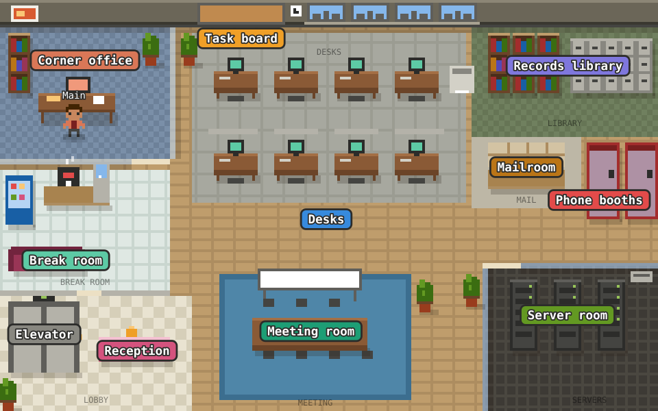

# Pixel Office

A Claude Code mod that draws a live pixel-art office in the Claude desktop app. Every agent in the session is a character with a job title. Main is the coordinator: it talks with you, splits big jobs into parts and hires helpers for them. Helpers arrive by elevator, get briefed in the meeting room, walk to the station that matches the tool they are using, carry their report back to whoever hired them and leave. You can see who is waiting on whom, what each one was asked to do, and what each one found.



The picture above is the mod's own drawing of a made-up session, and it is animated. Main hired three helpers at once and is coordinating: its bubble says it is waiting on two of them. The Researcher has finished and is carrying its report to Main. The Assistant found a failing test and hired a helper of its own, so it is coordinating too, from the meeting room. To try it yourself, jump to [Install](#install).

## A tour of the office



Each label names a zone. An agent walks to the zone that matches the tool it is using, so where a character stands tells you what it is doing. The same colours appear in the speech bubbles and in the legend under the picture.

| Zone | Stands for | What you see there |
|---|---|---|
| Corner office | Main's home base: thinking, or coordinating its helpers | Main sits here and goes back after every errand. Main's own edits and writes happen at this desk too. While it waits on helpers, its bubble says who: "waiting on Researcher", or "waiting on 3". |
| Desks | Edit, Write, NotebookEdit | Eight desks. Each helper gets its own and returns to it between jobs. |
| Records library | Read, Grep, Glob, LSP, Skill, ToolSearch | Looking things up: reading files and searching code. |
| Phone booths | WebFetch, WebSearch | Going out to the web. A booth light comes on while someone is on a call. |
| Mailroom | Outside services (`mcp__` tools) | Calling connected services. A parcel appears in the pigeonholes while someone is there. |
| Server room | Bash, PowerShell, background shells | Running commands. The rack lights flash while a command runs. |
| Meeting room | Briefings, SendMessage | A new helper is briefed here, and the whiteboard shows what it was hired to do. When one agent messages another, the sender carries an envelope over to the recipient, or comes here if it cannot find them. |
| Task board | TodoWrite, Task tools, plan updates | A cork board on the wall. Green notes are done, amber notes are still open. |
| Reception | Waiting on you: questions, permissions, plan approval | A blinking "!" bubble means this agent cannot go on until you answer. |
| Elevator | Agents arrive and leave | Helpers step out of it when they are hired and step back in when they finish. |
| Break room | Idle agents, and Main between turns after a while | Where anyone with nothing to do goes to rest. |

## Who's on the team

Every helper is named for the job its kind of agent does, so you can tell what it can and cannot do at a glance. The name Claude Code uses for that kind of agent is in its details box.

| In the office | Claude Code calls it | What it does |
|---|---|---|
| Main, the Coordinator | the main agent | Talks with you, splits the work into jobs, hires helpers and puts their reports together. |
| Researcher | `Explore` | Reads and searches, then reports what it found. Changes nothing. |
| Planner | `Plan` | Works out a step-by-step plan for a job. Changes nothing. |
| Assistant | `general-purpose` | Can read, edit and run commands to finish one job. |
| Clone | `fork` | A copy of its boss that knows everything its boss knew, sent off to do a side job. |
| Guide | `claude-code-guide` | Looks up how Claude Code itself works. |
| Contractor | (unknown) | A helper the office did not see being hired. |

Any other kind of agent is named after its type: a `code-reviewer` is a "Code reviewer". A helper the engine gave a name keeps it ("Scout"), and its details box adds the role. A second helper of the same kind is named for its job, as in "Test fails" (a researcher hired to find why a test fails); with no job to go on, or the same job, it is numbered, as in "Researcher 2".

**How they work together.** A boss hires a helper in one of two ways, and the office shows which:

- **And waits for the report.** The usual way. The feed says "Main hired Researcher and is waiting for its report". Until the reports come back, the boss is *coordinating*: it has nothing else in hand, so its speech bubble and its row say who it is waiting on. When the last one is back the feed says "Main has every report back and is reviewing the results".
- **To work alongside it**, in the background. The boss carries on with its own work meanwhile.

Helpers can hire helpers of their own, so a chain of delegation shows up as a deeper indent in the panel and as a second coordinator on the floor. Teammates (helpers started as part of a team) are standing colleagues rather than errands: nobody waits on them, and they rest in the break room between jobs.

## The life of a helper

A helper is a subagent: a short-lived agent that Main (or another agent) hires for one job. In the picture it goes through these steps.

1. **Hired.** Main hands over a one-line job description and a fuller brief. The feed says who hired whom and whether the boss is waiting ("Main hired Researcher and is waiting for its report: find the login code"), and a new row appears in the panel.
2. **Arrives by elevator.** The elevator doors open and the helper steps out.
3. **Briefed in the meeting room.** The helper walks to the meeting room and the whiteboard shows its objective, cut short if it is long. Its boss walks over to join it unless the boss is busy.
4. **Works at stations.** Each time the helper uses a tool it walks to the matching station. A speech bubble above its head says what it is doing, for example `auth.ts` or `Test the code`. It sets off with the helper, so you see the task before it arrives, and the furniture it is using is outlined in the station's colour until it leaves. Helpers standing close together get their bubbles in rows, one above the other; where the top of the floor leaves no room for another row, that helper's bubble is left out and the panel still says what it is doing. The feed says it in words: "Researcher is reading auth.ts", "Assistant is running a command to run the test suite" (a command is shown by what it is for, not by how it starts. Claude usually describes a command when it runs one, and that description is used when it fits the bubble. Without one the office reads the command: it skips the setup in front (`cd`, variables, `mkdir`), follows a chain, a pipe or a heredoc to the first real step, and names it, such as "Open a pull request", "Write bar.ts" or "Search for sceneTimeOf". It knows git, GitHub, the package managers, scripts, file and text tools, the network, containers and PowerShell; a program it does not know is shown as typed. A to-do list update shows the item being worked on, a search shows where it looks, and a call to an outside service shows what it is about).
5. **Carries its report to its boss.** When it is done, the helper walks over to its boss holding a yellow folder and hands it over. The feed quotes the start of the report, and the helper's details box keeps it.
6. **Leaves by elevator.** The helper rides away and its row in the panel turns grey and says how the job ended: "handed in its report", "was stopped" or "ran into a problem". A teammate goes to the break room instead of leaving, ready for its next job.

Two signs worth knowing. A red puff above a character means a tool call just hit an error. A blinking "!" bubble at reception means that agent is waiting on you, for a question, a permission or a plan to approve.

## Reading the panel


The numbers below match the numbers in the picture.

1. **The office.** The animated picture. Every character has a name tag, and the speech bubble shows what it is doing right now.
2. **What's happening.** A plain-English feed with the time of each line, newest at the bottom, eight lines long. It keeps the story: who hired whom, who messaged whom, who reported back, who needs you and what went wrong. Routine work (reading, editing, running a command) gets one line per agent, its latest, so a few busy helpers cannot push the story out of view.
3. **Who's doing what.** The team, as an org chart: indentation shows who reports to whom. Each row reads name, status, and what it is doing right now in words ("reading session.ts", "waiting on Planner and Assistant"). Green is working, teal is coordinating (waiting on helpers), yellow is "needs you" (waiting on your answer or permission), grey is idle or done. The dim line with an arrow under a helper is its objective, the job it was hired to do. Once two helpers of a kind have handed in a report, a helper of that kind still on the job also shows how long its predecessors took ("about 20s left", or "taking longer than usual"). That is a guess from earlier helpers, never a promise. In the picture the same estimate is a thin bar under the helper's feet that fills over the time left (it stays full and pulses amber once the helper is past what is usual); the words stay in the panel. A long chart ends with a "+N more" line.
4. **Details.** Click a name to open its details: its role and what that kind of agent does, its job, the start of the brief its boss wrote, what it is doing now, who it reports to and whether that boss is waiting on it, the start of its report once it has handed one in, what its work cost once it has (tokens, and the model it ran on), an "On the job" timer that counts up while it works, and, when the office has the examples for it, how long helpers of its kind usually take. A brief or report too long for one line has a "Read the full brief" (or report) link under it that opens the whole text, formatted. Click the name again to close the box.
5. **Show legend.** A button that lists every zone with its colour and the tools it stands for. It is the same list as the table above.
6. **Show this job.** A button that opens the recap of the job in front of you: see below.

The office is drawn as one picture, afresh each time the pane is drawn. The app starts a picture's animations over whenever it draws the pane, even when the picture has not changed, so a picture kept from an earlier draw would put every walker back where it was then and make it walk that stretch again. Walkers can still shift a little at a redraw when the app takes longer or shorter to show one picture than it took for the one before.

## The office cat

There is a cat in the office. It has nothing to do with your session: it patrols the corridor, sits for a while at a few favourite spots, and naps on the break-room couch, on a loop of about a minute. It is drawn as animations inside the picture, so it costs no extra redraws, and it carries on from the same point of its loop whenever the picture is drawn again. It is left out only when the picture is too large to draw the decorations.

## The recap of a job

A job is everything from a message you send until the next one. A notice from a background helper or another session that wakes Main is not a new message, so it carries on the same job. Once you have sent one, a **Show this job** button sits beside the legend button. It opens a recap that answers the question delegation raises: did splitting the work up help? If Main edited files itself rather than through a helper, the recap counts those edits too, so a coordinator that is not delegating shows.


- **The summary** says how long the job took, how many helpers it used and how many were at work at once, and what it cost in tokens. With two or more helpers whose work overlapped, it adds the time their work would have taken one after another, compared with the time it took together.
- **The timeline** has one bar per agent, indented by who hired whom, from when it started to when it handed in its report. Orange is Main, blue a helper Main waited for, green a helper working alongside. A tick, a square or a cross at the end says whether it handed in its report, was stopped, or ran into a problem. The colours were checked to stay apart for colour-blind readers, and the picture has a dark version for a dark screen.
- **One line per agent** under the timeline gives the same facts in words.

The recap only shows the job in front of you. To keep a short record of each job across sessions, set the `history` option to `last-20` (see Commands and options): the recap then lists your earlier jobs too. It is off unless you switch it on.

The recap also shows a **This session** line: the jobs, helpers, time and tokens of every job since the conversation started or was cleared, with the tokens split between Main and its helpers. It is kept in memory only, unless the `history` option is on, in which case each saved job keeps its token split too. Each agent shows its share of the job's tokens next to its time bar. An agent that is still running shows "running" there, because the engine only reports its tokens when it finishes.

## Your other sessions

With the `otherSessions` option on, the pane also lists your other Claude Code sessions on this computer, under the feed and the team, as **Your other sessions (3, 1 needs you)**. Each row names the session's project folder, its status and the kind of work it is doing, such as "api-server · working · running a command" or "website · needs you 3m"; the dim line under it is the start of the message it is working on. Sessions waiting on you come first, then the busy ones, then the idle ones. With `notify` on as well, a session that has waited on you for 30 seconds is said once as a toast here too.

Only sessions that have the option on, run this mod and use the same Claude config folder take part; each one shows the others. A row is for reading: it cannot take you to that session. A session that ends drops out at once, and one that crashed drops out within 20 seconds. Up to 32 sessions can take part at a time.

In a terminal session the pane shows the same feed and team as plain text, under a line telling you to open the session in the Claude desktop app to see the picture.

## Requirements

- Claude Code 2.1.295 or newer. Older versions report that the mod failed to load.
- The Claude desktop app for the pixel picture. In a terminal you get a text version of the same office.

## Install

**Option 1: Using only the Claude desktop app?** The desktop app's Code tab has no `/plugin install` and usually no `claude` on your PATH, but the app bundles its own Claude Code CLI. Start a Code session in the app and paste this prompt:

```
Install the "Pixel Office" Claude Code mod for me. Use the Claude Code CLI bundled with this desktop app: on Windows it is under `%APPDATA%\Claude\claude-code\<version>\…\claude.exe`, on macOS under `~/Library/Application Support/Claude/claude-code/<version>/` (pick the newest version folder; use `claude` on PATH only if it is 2.1.295 or newer). Run `<that claude> --version` and confirm it is 2.1.295 or newer. Then run `<that claude> plugin marketplace add sb2403/pixel-office` and `<that claude> plugin install pixel-office@pixel-office --config autoOpen=session-start`, show me `<that claude> plugin list`, and tell me to start a new session.
```

Approve the commands when Claude asks. The `--config autoOpen=session-start` in that prompt makes the office open at the start of every session; to change that, see Commands and options below. If the bundled version is older than 2.1.295, update the Claude desktop app first. Then start a new session and the office opens.

**Option 2: From a terminal.**

**Check your version.** Run `claude --version` in a terminal. It must show 2.1.295 or newer. If it is older, run `claude update` first.

**Install from a terminal.** Run these two commands in PowerShell, Command Prompt, or the macOS/Linux Terminal, not in the Claude chat box:

```
claude plugin marketplace add sb2403/pixel-office
claude plugin install pixel-office@pixel-office
```

The same two steps also work inside a terminal Claude Code session, as `/plugin marketplace add sb2403/pixel-office` then `/plugin install pixel-office@pixel-office`.

The Claude desktop app's built-in plugin browser won't find this mod; use Option 1 or Option 2 above. Once installed, it loads in desktop sessions too.

Nothing asks you anything: the install goes ahead at user scope, which is the default, and then prints a note that options are not set yet. That is fine: each stays at its default. `autoOpen`, the option for when the office opens by itself, stays at `on-first-subagent`, and `history` stays `off`. To pick another value, add `--config autoOpen=session-start` (or `never`) to the install line, or set it later with `/plugin configure pixel-office@pixel-office` or the `--values-stdin` form under Commands and options below. Start a new session: the office opens the first time a subagent is hired, or any time with `/office`.

**Fallback.** If those commands do not work, download the repository from GitHub (Code → Download ZIP, then unzip it) or run `git clone https://github.com/sb2403/pixel-office`. Then run these two commands in a terminal, with the path set to the unzipped or cloned folder:

```
claude plugin marketplace add "<path-to-the-unzipped-folder>"
claude plugin install pixel-office@pixel-office
```

The quotes are needed if the path has spaces in it, and harmless if it does not.

## Commands and options

**`/office`** shows or hides the office pane. Type it in any session, whatever `autoOpen` is set to. Its one-line reply is the only thing the mod ever adds to your conversation.

**`autoOpen`** decides when the office opens by itself:

- `on-first-subagent` (default): the first time a subagent is hired.
- `session-start`: as soon as a session starts.
- `never`: only when you run `/office`.

**`history`** decides whether the office keeps a record of your jobs across sessions:

- `off` (default): nothing is kept once the session ends.
- `last-20`: the newest 20 jobs are kept on this computer, in the mod's own store: the start of the message that began each one (up to 120 characters), when it started, how long it took, how many helpers and how many at once, and its tokens. The recap lists them under "Earlier jobs".

**`notify`** decides whether the office reminds you when an agent is waiting on you:

- `off` (default): no reminders.
- `after-30s`: once an agent has waited 30 seconds for your answer, permission or plan approval, the office says so once, naming the agent ("Researcher is waiting for your permission"). It shows a toast over the conversation, and raises a notification through your notification setting. In a terminal that is a desktop notification or a bell, as your terminal does them; the Claude desktop app shows the toast, and only your own notification hooks run there. Claude Code may already notify you when it needs you; if the two double up, leave this off.

**`otherSessions`** decides whether the office shows your other sessions on this computer (see Your other sessions above):

- `off` (default): nothing is written or read.
- `on`: each session that has it on keeps one small file in `pixel-office/sessions` under your Claude config folder (`~/.claude` unless `CLAUDE_CONFIG_DIR` says otherwise), rewritten every few seconds, and reads the others' files. The file holds the name of the project folder (not its path), whether the session is working, coordinating, idle or waiting on you and since when, the kind of work Main is doing in a few fixed words ("running a command", "editing files"), never a file name, command or host, and the start of the message it is working on (up to 60 characters). A session that ends clears its file; one that crashes leaves it until another session reuses the slot. Sessions that see a different config folder (another `CLAUDE_CONFIG_DIR`, or another home folder, as Git Bash and PowerShell can) do not see each other.

**`debug`** is for troubleshooting (for example, walkers that jump), and is off by default:

- `off` (default): nothing is recorded, and nothing extra runs.
- `on`: the mod keeps a log of what it does and writes it to `pixel-office/debug/log.jsonl` inside the plugin's folder, rewritten at most once a second and capped at the newest 3000 lines. It also draws two invisible one-cell probes in the pane (top and bottom) that report when the app mounts them, which happens again after the app unmounts and remounts them (for example when you scroll), and once a second the size of their region. Only event kinds, agent ids, tool names, counts, sizes and timings are logged: never commands, file names, labels, briefs, reports or any of your text. Send the file when asked to look into a problem, and set `debug` back to `off` afterwards.
- How to read it: one JSON object per line, with `t` (milliseconds) and `kind`: `render` (the pane was drawn, with its scroll and panel state), `event` (something an agent did), `flush` (a batch of events applied, and how long it took), `turn-start`, `turn-ignored` (a helper's own turn, which is not a new task) and `probe` (what the pane reported back).

Optional. To set it while installing, instead of answering the options screen, run this in place of the second install command (after `claude plugin marketplace add sb2403/pixel-office`):

```bash
claude plugin install pixel-office@pixel-office --config autoOpen=session-start
```

To change it later, run `/plugin configure pixel-office@pixel-office` inside Claude Code, or save the value from a terminal by piping a JSON object to `configure`:

```bash
echo '{"autoOpen":"never"}' | claude plugin configure pixel-office@pixel-office --values-stdin
```

That one-liner is for PowerShell and for macOS/Linux shells. In Command Prompt (cmd.exe) the single quotes would be passed through as part of the text, so use `/plugin configure` there, or run it from PowerShell.

Either way the new value applies to sessions you start afterwards. `claude plugin configure pixel-office@pixel-office` on its own only shows the options and whether each is set; it changes nothing.

## What does it mean when...

**Main is "idle" instead of "working"?** Main is working from the moment you send a message until it finishes its turn. A working Main with no speech bubble is thinking between tools, in the corner office. When the turn ends Main reads "idle" and stays where it stood. A few seconds later it walks back to the corner office.

**Main says "coordinating"?** It hired helpers and is waiting for their reports, with nothing else in hand. Its bubble and its row name who it is waiting on. However long they take, a coordinating boss is never sent to the break room. Any helper that hires its own helpers coordinates the same way.

**A helper that left comes back?** Its boss called it back for more work, with everything it knew the first time. It steps out of the elevator again (a teammate walks over from the break room), is briefed in the meeting room, and the feed says "Main called Researcher back". It keeps its name, and its last report stays in its details box until it hands in a new one.

**Someone is carrying a folder or an envelope?** A folder is a report on its way to the boss who asked for it; an envelope is a message on its way to another agent. Each disappears at the moment it is handed over.

**What do "38k tokens (31k reused)" mean?** Tokens are the pieces of text a model reads and writes; they are what an agent's work costs. Every helper starts by reading its brief and whatever it looks up, so hiring helpers buys parallel work with tokens. "Reused" tokens were served from the prompt cache, text the model had read moments before, and cost far less than fresh ones. The count is summed over all of an agent's turns. The office shows tokens, not money, because prices change.

**A name tag is under someone's feet?** Two characters stand so close that their name tags would cover each other, as when a boss sits beside the helper it is briefing. One tag moves below the feet so both stay readable.

**Someone is in the break room?** Anyone who has had nothing to do for 10 minutes goes there, Main included. Teammates also go there after they hand in a report. They walk back to work as soon as something happens.

**An agent is called "Contractor"?** The office only learns about a helper when it sees it being hired. An agent that starts working without that appears at the elevator in a grey shirt, named Contractor, and reports to Main.

**Agents stand in a line beside a station?** Each station has a fixed number of places to stand, and the library has five. When they are all taken, the next agent stands just beside the last place, so you can still see everyone.

**A helper is still in the meeting room after a minute?** A briefing normally ends when the helper uses its first tool. If that has not happened after about a minute, the office sends the helper to its desk so the room is free for the next briefing.

**The office suddenly empties?** `/clear` starts a new conversation, so the office starts over with only Main.

**The windows are dark?** The windows follow your computer's clock: daylight from 7:00 to 19:00, night outside those hours. It is decoration, and says nothing about your session.

## Updating (users)

Installed sessions run the installed copy of the mod, not the files in this repository, so a change only reaches you once the maintainer has published a new version. To get it:

```bash
claude plugin marketplace update pixel-office
claude plugin update pixel-office@pixel-office
```

Then start a new session. (`pixel-office` is the name this marketplace registers under, however it was added.)

## Releasing a change (maintainers)

Raise `version` in `pixel-office/.claude-plugin/plugin.json`, commit, and push. Without a new version, installed copies do not pick up the change. Users then follow Updating (users) above.

## Good to know

- It is built on an early-access mod API that may change between Claude Code releases, so a new release can need a new version of this mod.
- An organization policy can disable mods. If yours does, the office will not load.
- Cost: it uses no model tokens. The only thing that enters your conversation is the one-line reply to `/office`.
- Privacy: it reads tool names, file names, commands and the descriptions Claude gives them, search patterns, web hosts, message summaries, the task descriptions helpers are given, each helper's brief and report (up to 2,000 characters each for the ten most recently finished helpers, 200 for older ones), and the start of each message you send (up to 120 characters, to name the job), inside your own Claude Code, only to draw the office. It keeps them in the session's own state and sends nothing anywhere. With `history` set to `last-20` it also keeps a short record of each job on this computer across sessions, and with `otherSessions` on it shares a few words about the session with your other sessions through a file on this computer, both as described under Commands and options; each is off unless you switch it on.

## Keeping Main a coordinator (coordinator-guard)

Pixel Office only shows who coordinates; it does not make Main do it. `coordinator-guard` is a second, optional plugin in this repository that does. It is **off until you switch it on**, for the session:

| Command | What it does |
| --- | --- |
| `/coordinator on` | Main is refused when it tries to change a file itself, and told to hire a helper with the Agent tool. |
| `/coordinator off` | Main may edit again. |
| `/coordinator` or `/coordinator status` | Says whether it is on. |

While it is on, Main is refused `Edit`, `Write` and `NotebookEdit`, and shell commands that write a file: a redirect (`> out`, `>> log`), `tee`, an in-place edit (`sed -i`, `perl -i`), PowerShell's `Set-Content`, `Add-Content` and `Out-File`, and `git apply` or `patch`. Main can still read, search, run tests and git, hire helpers, and write to its own memory, plans and scratch folders. A helper is never held to it: only the main loop is. It cannot see what a script does, so `python script.py` that writes a file gets through; it is a nudge towards delegating, not a lock, and if the guard itself fails the call goes ahead.

Install it with the same marketplace: `claude plugin install coordinator-guard@pixel-office`.

## Develop

From the repository root:

```bash
claude plugin test pixel-office
claude plugin validate .
claude plugin validate --strict pixel-office
```

`plugin test` needs Claude Code 2.1.295 or newer. The desktop app runs its own copy of Claude Code, which can be newer than the `claude` on your PATH; the mod is loaded by the desktop app's copy, so judge a `claude plugin list` failure from an older terminal install with that in mind (the desktop copy lives under `%APPDATA%\Claude\claude-code` on Windows). `validate .` checks the marketplace file. `validate --strict` checks the mod and treats warnings as errors; it passes on this tree.

GitHub runs the same three commands, and the guard's tests and validation, on every pull request and push, on Claude Code 2.1.295 (the oldest version this README promises) and on the newest release, and again every Monday so a Claude Code release that breaks the mod shows up before anyone reports it. It also draws the README pictures again and fails if they no longer match the drawing code: after changing what the office draws, run `npx -y tsx@4.19.2 scripts/render-preview.ts` and commit `docs/images`.

Type-checking stays a local step, because the API declarations it needs are only written out by a running Claude Code session. Load the `plugin-authoring` skill in a session, take the `claude-code.d.ts` path it names, and point a `tsconfig` at it with `pixel-office/hooks`, `pixel-office/types` and `pixel-office/tests` included; the spec's plan has the full file. `tsconfig.typecheck.json` is ignored by git for that reason.

Licensed under the MIT License.
