# Pixel Office

A Claude Code mod that draws a live pixel-art office in the Claude desktop app. Every agent in the session is a character: Main works from the corner office, subagents arrive by elevator, get briefed in the meeting room, walk to the station that matches the tool they are using, hand their report back and leave.


The picture above is the mod's own drawing of a made-up session, and it is animated: Main is writing notes in the corner office, three helpers are at work, and a fourth is walking in to be briefed. To try it yourself, jump to [Install](#install).

## A tour of the office


Each label names a zone. An agent walks to the zone that matches the tool it is using, so where a character stands tells you what it is doing. The same colours appear in the speech bubbles and in the legend under the picture.

| Zone | Stands for | What you see there |
|---|---|---|
| Corner office | Main's home base; thinking between tools | Main sits here and goes back after every errand. Main's own edits and writes happen at this desk too. |
| Desks | Edit, Write, NotebookEdit | Eight desks. Each helper gets its own and returns to it between jobs. |
| Records library | Read, Grep, Glob, LSP, Skill, ToolSearch | Looking things up: reading files and searching code. |
| Phone booths | WebFetch, WebSearch | Going out to the web. A booth light comes on while someone is on a call. |
| Mailroom | Outside services (`mcp__` tools) | Calling connected services. A parcel appears in the pigeonholes while someone is there. |
| Server room | Bash, PowerShell, background shells | Running commands. The rack lights flash while a command runs. |
| Meeting room | Briefings, SendMessage | A new helper is briefed here, and the whiteboard shows what it was hired to do. When one agent messages another, the sender walks over to the recipient, or comes here if it cannot find them. |
| Task board | TodoWrite, Task tools, plan updates | A cork board on the wall. Green notes are done, amber notes are still open. |
| Reception | Waiting on you: questions, permissions, plan approval | A blinking "!" bubble means this agent cannot go on until you answer. |
| Elevator | Agents arrive and leave | Helpers step out of it when they are hired and step back in when they finish. |
| Break room | Idle agents, and Main between turns after a while | Where anyone with nothing to do goes to rest. |

## The life of a helper

A helper is a subagent: a short-lived agent that Main (or another agent) hires for one job. In the picture it goes through these steps.

1. **Hired.** Main hands over a one-line job description. The feed says who hired whom ("Main hired Explore: find the login code") and a new row appears in the org chart.
2. **Arrives by elevator.** The elevator doors open and the helper steps out.
3. **Briefed in the meeting room.** The helper walks to the meeting room and the whiteboard shows its objective, cut short if it is long. Its boss walks over to join it unless the boss is busy.
4. **Works at stations.** Each time the helper uses a tool it walks to the matching station. A speech bubble above its head names the file, command, search or website, for example `auth.ts` or `npm test`.
5. **Hands its report to its boss.** When it is done, the helper walks over to its boss to hand in the report.
6. **Leaves by elevator.** The helper rides away and its row in the org chart turns grey and says "left". A teammate (a helper started as part of a team) goes to the break room instead of leaving, ready for its next job.

Two signs worth knowing. A red puff above a character means a tool call just hit an error. A blinking "!" bubble at reception means that agent is waiting on you, for a question, a permission or a plan to approve.

## Reading the panel



The numbers below match the numbers in the picture.

1. **The office.** The animated picture. Every character has a name tag, and the speech bubble shows what it is doing right now.
2. **What's happening.** A plain-English feed of the latest events, each with the time it happened. The newest line is at the bottom, and only the last eight are kept.
3. **Who reports to whom.** The org chart. Indentation shows who reports to whom. Each row reads name, status, place: green for working, yellow for waiting on you, grey for idle or done. The dim line with an arrow under a helper is its objective, the job it was hired to do. Two helpers of the same kind are numbered, as in `general-purpose 2`. A long chart ends with a "+N more" line.
4. **Details.** Click a name in the org chart to open its details: what kind of agent it is, its task, what it is doing now, who it reports to, and an "On the job" timer that counts up while it works. Click the name again to close the box.
5. **Show legend.** A button that lists every zone with its colour and the tools it stands for. It is the same list as the table above.

In a terminal session the pane shows the same feed and org chart as plain text, under a line telling you to open the session in the Claude desktop app to see the picture.

## Requirements

- Claude Code 2.1.295 or newer. Older versions report that the mod failed to load.
- The Claude desktop app for the pixel picture. In a terminal you get a text version of the same office.

## Install

**Option 1: Using only the Claude desktop app?** The desktop app's Code tab has no `/plugin install` and usually no `claude` on your PATH, but the app bundles its own Claude Code CLI. Start a Code session in the app and paste this prompt:

```
Install the "Pixel Office" Claude Code mod for me. Use the Claude Code CLI bundled with this desktop app: on Windows it is under `%APPDATA%\Claude\claude-code\<version>\…\claude.exe`, on macOS under `~/Library/Application Support/Claude/claude-code/<version>/` (pick the newest version folder; use `claude` on PATH only if it is 2.1.295 or newer). Run `<that claude> --version` and confirm it is 2.1.295 or newer. Then run `<that claude> plugin marketplace add sb2403/pixel-office` and `<that claude> plugin install pixel-office@pixel-office --config autoOpen=session-start`, show me `<that claude> plugin list`, and tell me to start a new session.
```

Approve the commands when Claude asks. The `--config autoOpen=session-start` in that prompt makes the office open at the start of every session; to change that, see Commands and options below. If the bundled version is older than 2.1.295, update the Claude desktop app first. Then start a new session and the office opens.

**Option 2: From a terminal.**

**Check your version.** Run `claude --version` in a terminal. It must show 2.1.295 or newer. If it is older, run `claude update` first.

**Install from a terminal.** Run these two commands in PowerShell, Command Prompt, or the macOS/Linux Terminal, not in the Claude chat box:

```
claude plugin marketplace add sb2403/pixel-office
claude plugin install pixel-office@pixel-office
```

The same two steps also work inside a terminal Claude Code session, as `/plugin marketplace add sb2403/pixel-office` then `/plugin install pixel-office@pixel-office`.

The Claude desktop app's built-in plugin browser won't find this mod; use Option 1 or Option 2 above. Once installed, it loads in desktop sessions too.

Nothing asks you anything: the install goes ahead at user scope, which is the default, and then prints a note that one option is not set yet. That is fine. `autoOpen`, the option for when the office opens by itself, stays at its default of `on-first-subagent`. To pick another value, add `--config autoOpen=session-start` (or `never`) to the install line, or set it later with `/plugin configure pixel-office@pixel-office` or the `--values-stdin` form under Commands and options below. Start a new session: the office opens the first time a subagent is hired, or any time with `/office`.

**Fallback.** If those commands do not work, download the repository from GitHub (Code → Download ZIP, then unzip it) or run `git clone https://github.com/sb2403/pixel-office`. Then run these two commands in a terminal, with the path set to the unzipped or cloned folder:

```
claude plugin marketplace add "<path-to-the-unzipped-folder>"
claude plugin install pixel-office@pixel-office
```

The quotes are needed if the path has spaces in it, and harmless if it does not.

## Commands and options

**`/office`** shows or hides the office pane. Type it in any session, whatever `autoOpen` is set to. Its one-line reply is the only thing the mod ever adds to your conversation.

**`autoOpen`** is the one option. It decides when the office opens by itself:

- `on-first-subagent` (default): the first time a subagent is hired.
- `session-start`: as soon as a session starts.
- `never`: only when you run `/office`.

Optional. To set it while installing, instead of answering the options screen, run this in place of the second install command (after `claude plugin marketplace add sb2403/pixel-office`):

```bash
claude plugin install pixel-office@pixel-office --config autoOpen=session-start
```

To change it later, run `/plugin configure pixel-office@pixel-office` inside Claude Code, or save the value from a terminal by piping a JSON object to `configure`:

```bash
echo '{"autoOpen":"never"}' | claude plugin configure pixel-office@pixel-office --values-stdin
```

That one-liner is for PowerShell and for macOS/Linux shells. In Command Prompt (cmd.exe) the single quotes would be passed through as part of the text, so use `/plugin configure` there, or run it from PowerShell.

Either way the new value applies to sessions you start afterwards. `claude plugin configure pixel-office@pixel-office` on its own only shows the options and whether each is set; it changes nothing.

## What does it mean when...

**Main is "idle" instead of "working"?** Main is working from the moment you send a message until it finishes its turn. A working Main with no speech bubble is thinking between tools, in the corner office. When the turn ends Main reads "idle" and stays where it stood. A few seconds later it walks back to the corner office.

**Someone is in the break room?** Anyone who has had nothing to do for 10 minutes goes there, Main included. Teammates also go there after they hand in a report. They walk back to work as soon as something happens.

**An agent is called "Contractor"?** The office only learns about a helper when it sees it being hired. An agent that starts working without that appears at the elevator in a grey shirt, named Contractor, and reports to Main.

**Agents stand in a line beside a station?** Each station has a fixed number of places to stand, and the library has five. When they are all taken, the next agent stands just beside the last place, so you can still see everyone.

**A helper is still in the meeting room after a minute?** A briefing normally ends when the helper uses its first tool. If that has not happened after about a minute, the office sends the helper to its desk so the room is free for the next briefing.

**The office suddenly empties?** `/clear` starts a new conversation, so the office starts over with only Main.

**The windows are dark?** The windows follow your computer's clock: daylight from 7:00 to 19:00, night outside those hours. It is decoration, and says nothing about your session.

## Updating (users)

Installed sessions run the installed copy of the mod, not the files in this repository, so a change only reaches you once the maintainer has published a new version. To get it:

```bash
claude plugin marketplace update pixel-office
claude plugin update pixel-office@pixel-office
```

Then start a new session. (`pixel-office` is the name this marketplace registers under, however it was added.)

## Releasing a change (maintainers)

Raise `version` in `pixel-office/.claude-plugin/plugin.json`, commit, and push. Without a new version, installed copies do not pick up the change. Users then follow Updating (users) above.

## Good to know

- It is built on an early-access mod API that may change between Claude Code releases, so a new release can need a new version of this mod.
- An organization policy can disable mods. If yours does, the office will not load.
- Cost: it uses no model tokens. The only thing that enters your conversation is the one-line reply to `/office`.
- Privacy: it reads tool names, file names, commands, search patterns, web hosts and the short task descriptions helpers are given, inside your own Claude Code, only to draw the office. It sends nothing anywhere.

## Develop

From the repository root:

```bash
claude plugin test pixel-office
claude plugin validate .
claude plugin validate --strict pixel-office
```

`plugin test` needs Claude Code 2.1.295 or newer. `validate .` checks the marketplace file. `validate --strict` checks the mod and treats warnings as errors; it passes on this tree.

Licensed under the MIT License.
